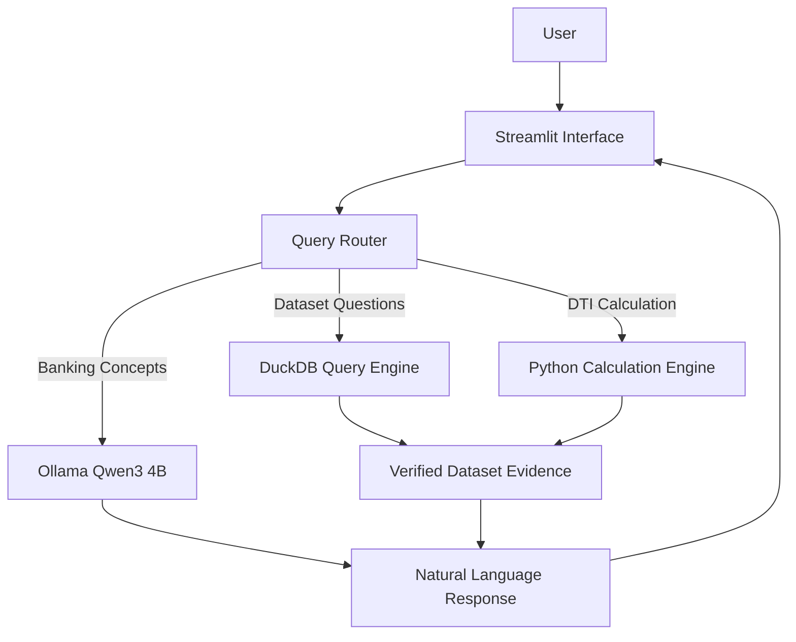

# System Architecture

## Banking and Credit Risk Analysis Assistant

## Components

### Custom Transformer Research Model

The project developed an 80,802,560-parameter decoder-only
Transformer architecture with:

- Hidden size: 256
- Four Transformer layers
- Four query attention heads
- Two key/value groups
- Feed-forward dimension: 768
- RMSNorm
- RoPE
- SwiGLU

V9 was evaluated experimentally. Its held-out outcome
classification accuracy was 54%, and its profile-level
diagnostic ROC-AUC was 0.5148.

Its generation quality was not sufficient for production use.

### Deployed Language Component

The local assistant uses the existing pretrained Qwen3 4B
model through Ollama. It is not the custom-trained 80.8M
Transformer.

### Dataset Engine

DuckDB queries the complete labelled LendingClub
accepted-loan Parquet store:

- 1,190,174 labelled historical records.
- Fully Paid: 952,713.
- Charged Off: 237,461.

### Routing

- General banking concepts: Ollama.
- Exact historical dataset questions: DuckDB.
- DTI arithmetic: deterministic Python calculation.
- Repeated results: in-memory cache.

## Limitations

Historical loan outcomes are not guaranteed future outcomes.
The research prototype is not a validated lending decision
or individual credit scoring system.
